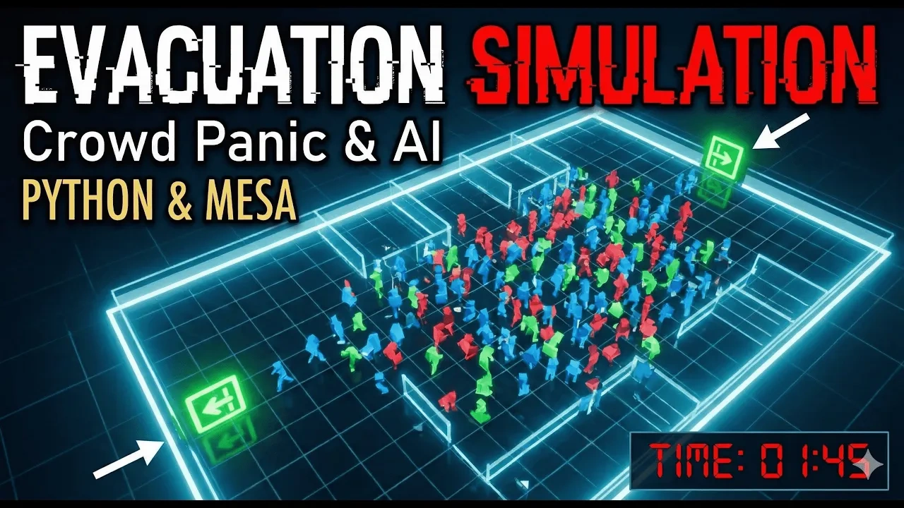
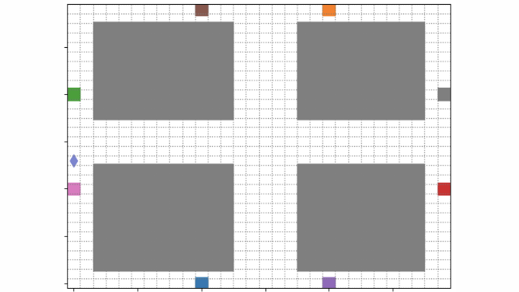
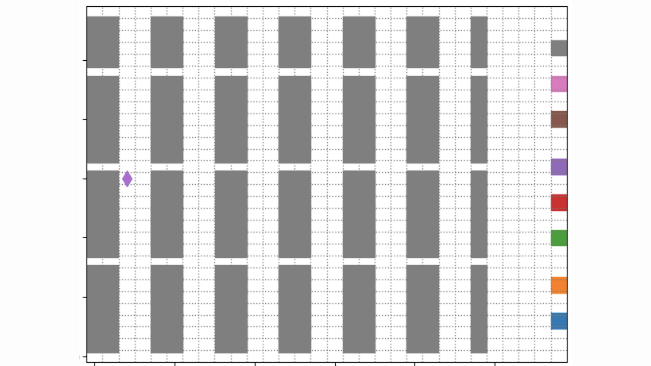
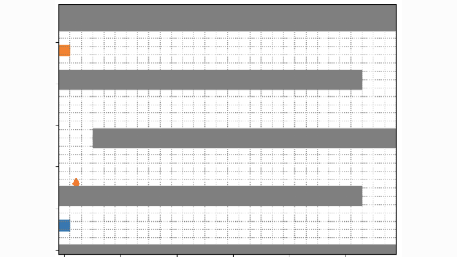
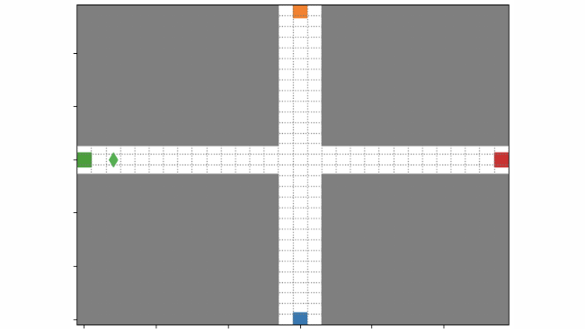
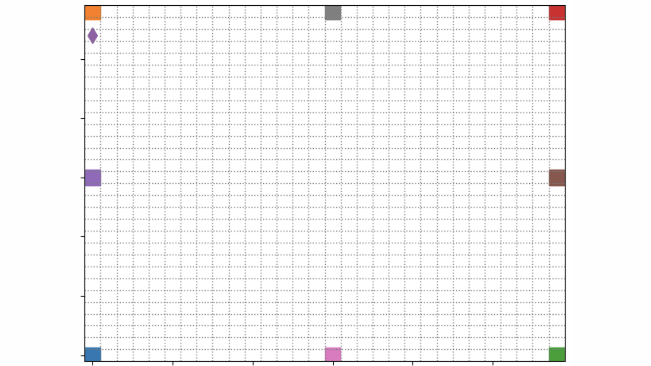
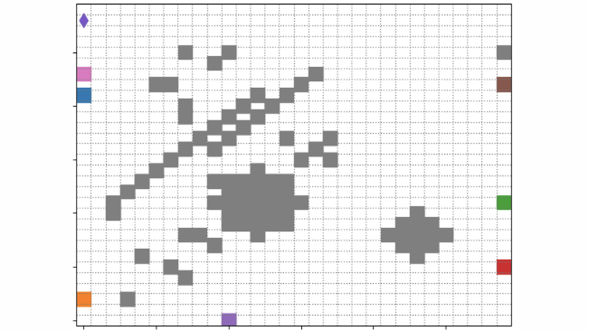
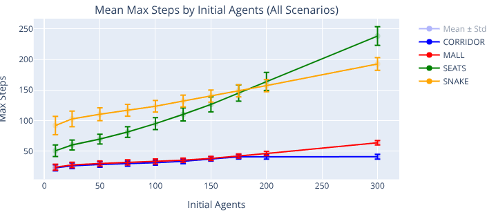
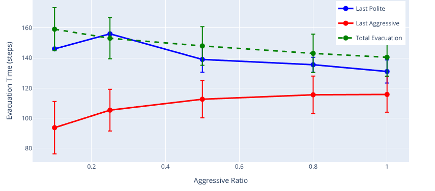
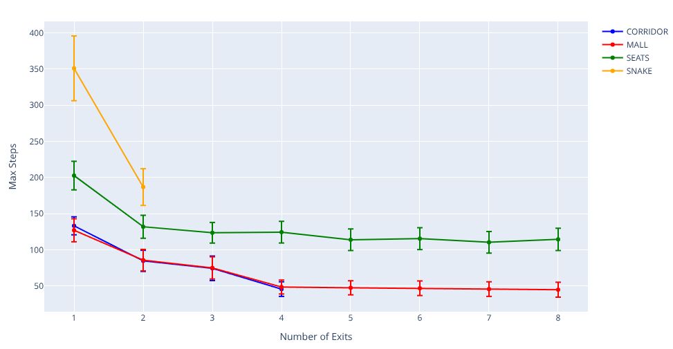

# Multi-Agent Crowd Evacuation Simulation

Developed together with [Miquel Gómez Corral](https://github.com/MiquelGomezCorral).

   

An agent-based simulation of crowd evacuation built with [Mesa](https://mesa.readthedocs.io/). Agents with different behaviours move on a grid towards the exits, and large batch experiments measure how crowd density, agent types, pathfinding, exit choice, number of exits and exit width affect evacuation. It was a multi-agent systems project at Universitat Politècnica de València; the write-up is in [`thesis/thesis_es.pdf`](thesis/thesis_es.pdf) (Spanish).

<div align="center">
  <a href="https://www.youtube.com/watch?v=HJeZalWTbt4">
    
  </a>
  <br>
  <em>Click to watch the demo video (YouTube)</em>
</div>

## Model

- **Agent types:** polite (yield, sensitive to crowding), aggressive (push, less sensitive to deadlock) and slow (reduced speed, very sensitive to density).
- **Environment:** discrete grid (`OrthogonalMooreGrid`) with six scenarios, shown below.
- **Pathfinding:** configurable Manhattan, BFS or A\* towards the exits.
- **Metrics:** evacuation time (steps), evacuation rate, macro and micro speed, local density and deadlock factor, per agent type and globally.
- **Experiments:** 1000 runs per configuration, run in parallel, over 7 dimensions: agent density, aggressive agents, slow agents, pathfinding, exit preference, number of exits and exit width.

<div align="center">
<table>
  <tr>
    <td align="center"><br><sub>Mall scenario</sub></td>
    <td align="center"><br><sub>Seats scenario</sub></td>
    <td align="center"><br><sub>Snake scenario</sub></td>
  </tr>
  <tr>
    <td align="center"><br><sub>Corridor scenario</sub></td>
    <td align="center"><br><sub>Open scenario</sub></td>
    <td align="center"><br><sub>Random scenario</sub></td>
  </tr>
</table>
<p><sub>Grey cells are walls, coloured squares on the border are exits. <b>OPEN</b>: no walls. <b>MALL</b>: four wall blocks split by wider crossing corridors, walkable outer ring. <b>CORRIDOR</b>: the same layout with narrower corridors. <b>SEATS</b>: theatre-style rows of obstacles. <b>SNAKE</b>: a winding path with forced turns. <b>RANDOM</b>: randomly placed obstacles and exits.</sub></p>
</div>

## Results

Averages over 1000 runs per configuration, from the full analysis in [`docs/experiments_analysis_report.md`](docs/experiments_analysis_report.md) (the report covers four scenarios: Corridor, Mall, Seats, Snake).

| Headline finding | Result |
|---|---|
| **Crowd density** (10 to 300 agents) | Evacuation time **+80% (Corridor) to +370% (Seats)** vs the 10-agent baseline; deadlock factor 0.00 to 0.22 |
| **Aggressive crowd** (Seats) | **About 14% faster** than a 100% polite one (205 vs 238 steps); evacuation rate +15%, deadlock factor 0.61 vs 0.73 |
| **Forced exit preference** | Evacuation time **+100% to +1000%** vs opportunistic (nearest-exit) choice; deadlock factor 0.13 without preference vs 3.33 with it |

More results:

- **Slow agents:** a fully slow crowd increased evacuation time by about 45%.
- **Pathfinding:** A\* was faster in open maps (Mall, +33%); BFS was more robust in obstacle-dense grids (Seats).
- **Exits:** gains levelled off after about 4 exits (deadlock 0.75 with 1 exit vs 0.07 with 4).
- **Exit width:** widening exits from 1x to 4x lowered deadlock from 0.42 to 0.03 in open layouts, but made less than 1% difference in Seats, where internal navigation is the bottleneck.

<div align="center">
<p align="center"><br><sub>Mean max steps vs initial agents, per scenario</sub><br><sub><b>Takeaway:</b> Seats and Snake degrade fastest as the crowd grows; Corridor and Mall stay low. Seats shows the largest rise (+370%), Corridor the smallest (+80%).</sub></p>
<p align="center"><br><sub>Evacuation time by agent type vs aggressive ratio (200 agents)</sub><br><sub><b>Takeaway:</b> As the aggressive share grows, total evacuation time falls. In Seats a fully aggressive crowd needs 205 steps vs 238 for a polite one.</sub></p>
<p align="center"><br><sub>Max steps vs number of exits, per scenario</sub><br><sub><b>Takeaway:</b> Gains plateau after about 4 exits, once the bottleneck moves from the door to the room itself.</sub></p>
</div>

The remaining charts (slow agents, exit width, pathfinding) are in the [full report](docs/experiments_analysis_report.md).

## Repository layout

```
app/
  main.py                CLI (experiments)
  scripts/experiments.py batch experiment runner
  src/definitions/       scenarios, agent/model params, experiments
  src/models/            Mesa agents, crowd model, visualization
  src/data/              metrics computation
notebooks/               01_simulation_demo, 02_experiment_analysis
docs/                    experiment analysis report
thesis/                  PDF + LaTeX sources (UPV class file not included)
assets/                  figures
```

## Setup

Requires Python 3.12.

```bash
python3.12 -m venv venv && source venv/bin/activate
pip install uv
uv pip install -r requirements.txt
pip install -e app/
mkdir -p logs

# batch experiments: writes CSVs to logs/
cd app && python main.py experiments

# interactive Solara/Jupyter demo: open the notebook
#   notebooks/01_simulation_demo.ipynb
```

`requirements-original.txt` keeps the exact pins used before the cleanup.
